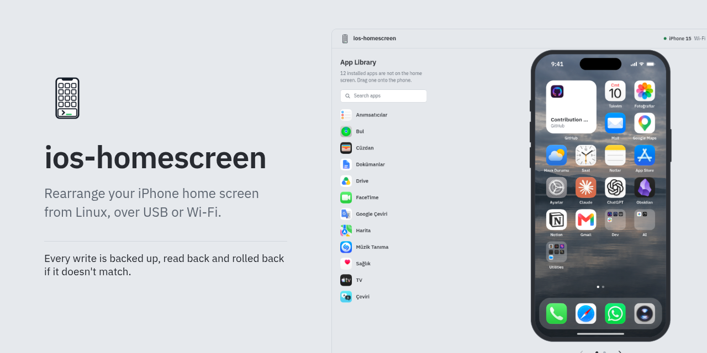

<h1 align="center">ios-homescreen</h1>

<p align="center">
Pull your iPhone's home screen into a text file, edit it, and push it back safely from Linux, over USB or Wi-Fi.
</p>

<p align="center">
<a href="https://github.com/YakupEmreYerli/ios-homescreen/actions/workflows/ci.yml"></a>
<a href="LICENSE"></a>

</p>

<p align="center"><a href="README.tr.md">Türkçe</a></p>



Rearranging dozens of icons by dragging them around on the phone is slow. ios-homescreen
pulls the current layout into a TOML file you can edit in any text editor, shows what your
edits would change, and pushes the result to the phone. Every push asks first, saves a
backup, checks the result by reading the phone again, and rolls back automatically if the
phone does not end up with the layout you asked for.

If you would rather drag icons around, `ios-homescreen editor` does the same in a browser.

## Features

- Pulls the dock, pages, folders (including multi-page folders), widgets, widget stacks,
  web clips, Safari web apps and offloaded apps into an editable TOML file, and lists the
  apps that are only in the App Library at the end of it.
- Refers to apps by bundle id or by the name under the icon.
- Checks a layout before anything touches the phone: unknown or duplicate items, a full dock,
  pages over 24 cells (widgets count by size), empty or nested folders, widgets in folders.
- Apps you leave out of the layout go to the App Library and stay there.
- Shows what will move, what goes to the App Library and what comes back before you write.
- Refuses to push when the phone was changed since the pull, asks before every write, saves
  a backup, and checks the result by reading the phone again. If the check fails, the backup
  is written back. `ios-homescreen restore latest` undoes a push.
- Works over USB, or over Wi-Fi (iOS 17 and later) after a one-time setup over USB. Neither
  needs root or Developer Mode.
- Keeps pull snapshots and backups in `~/.local/share/ios-homescreen`; only the layout file
  goes where you say.
- Has a browser editor (`ios-homescreen editor`): drag apps, folders and widgets on a
  picture of your home screen with its own icons, see every change before it is written,
  and apply it with the same safety steps. A demo mode needs no phone.
- Can be used from Python: the CLI is a thin layer over `ios_homescreen.api`.

## Requirements

- Linux. macOS may work but has not been tested.
- Python 3.11 or newer.
- `usbmuxd`, installed and running. Most distributions ship it as `usbmuxd`
  (`sudo pacman -S usbmuxd`, `sudo apt install usbmuxd`, `sudo dnf install usbmuxd`).
- An iPhone that trusts this computer. Connect it with a cable, unlock it and tap
  **Trust This Computer**, then enter the passcode. You need to do this once.

## Install

With [uv](https://docs.astral.sh/uv/):

```bash
uv tool install git+https://github.com/YakupEmreYerli/ios-homescreen
```

With [pipx](https://pipx.pypa.io/):

```bash
pipx install git+https://github.com/YakupEmreYerli/ios-homescreen
```

The browser editor uses Starlette and uvicorn, which pymobiledevice3 already installs. The `ui`
extra names them explicitly, in case that ever changes:

```bash
uv tool install "ios-homescreen[ui] @ git+https://github.com/YakupEmreYerli/ios-homescreen"
```

From a clone, for development:

```bash
git clone https://github.com/YakupEmreYerli/ios-homescreen
cd ios-homescreen
uv sync
uv run ios-homescreen --help
```

## Quick start

```bash
# 1. Read the phone into layout.toml. Read-only; nothing is written to the phone.
ios-homescreen pull

# 2. Edit it: move lines around, add apps from the list at the end, make folders.
$EDITOR layout.toml

# 3. See what would change. Offline.
ios-homescreen check

# 4. Write it. push shows the changes and asks; then backup, write, verify, roll back if needed.
ios-homescreen push
```

To undo a push, write back the backup it made:

```bash
ios-homescreen restore latest
```

## Commands

| Command | What it does | Talks to the phone |
| --- | --- | --- |
| `pull [LAYOUT]` | Reads the home screen into a layout file (`layout.toml` by default) and keeps the phone's state as a snapshot | Reads only |
| `check [LAYOUT]` | Checks the file and lists what `push` would change, compared with the pull | No |
| `push [LAYOUT]` | Shows the changes, asks, then backs up, writes, verifies and rolls back on failure | Writes |
| `editor` | Opens the browser editor on 127.0.0.1 | Reads; writes only when you press Apply |
| `backups` | Lists the backups made before each write: when, which iPhone, what the layout held | No |
| `restore BACKUP` | Writes a backup back (`latest`, a name from `backups`, or a file), with the same steps as `push` | Writes |
| `wifi setup\|status\|off` | Sets up, checks or turns off Wi-Fi access to the phone | Yes |

`pull` will not replace a layout file that has edits you have not pushed; pull into another
file, or pass `--overwrite`. `check` and `push` take `--allow-removal` (see the layout
reference); `push` and `restore` take `--force` (see the safety model). `backups` shows the 20
newest; `--all` lists every one. Every command except `wifi` takes `--data-dir DIR`;
`push`, `restore`, `editor` and `backups` also take `--backup-dir DIR`.

Connection options, for `pull`, `push`, `restore`, `editor` and `wifi`:

| Option | Meaning |
| --- | --- |
| *(none)* | USB through usbmuxd |
| `--wifi` | Wi-Fi (iOS 17 or later); run `wifi setup` over USB once first |
| `--udid UDID` | Pick a device when several are connected or paired |
| `--discovery-timeout SECONDS` | How long to listen for Bonjour answers (default 5) |
| `--connect-timeout SECONDS` | Time limit for opening the connection (default 30) |

Write options, for `push` and `restore` (and for `editor`, except `--yes`):

| Option | Meaning |
| --- | --- |
| `-y`, `--yes` | Write without asking. Needed when there is no terminal to ask in (scripts, pipes) |
| `--backup-dir DIR` | Where the automatic backup goes (default `DATA_DIR/backups`) |
| `--verify-attempts N` | Re-reads used to verify the write (default 6) |
| `--verify-interval SECONDS` | Pause between those re-reads (default 3) |
| `--write-timeout SECONDS` | Time limit for sending the layout (default 10) |
| `--read-timeout SECONDS` | Time limit for each read (default 30) |

Exit codes: `0` done (or nothing to do); `1` error, nothing was written (this includes a
phone that changed since the pull); `2` usage error, or the write was not confirmed (you
answered no, or there was no terminal and no `--yes`); `3` the new layout did not verify
and the backup was written back; `4` that did not verify either. The backup file is kept
in every case.

## Layout file

A layout has a `[dock]` table and one `[[pages]]` table per page, each with an `items`
array in home screen order: left to right, top to bottom.

```toml
[dock]
items = ["Phone", "Safari", "Messages", "Camera"]

[[pages]]
items = [
  { type = "widget", id = "6F1D3A52-0000-4000-8000-000000000001" },  # Weather, medium
  "com.apple.mobilecal",        # Calendar, by bundle id
  "Mail",                       # or by the name under the icon
  { type = "folder", name = "Utilities", items = ["Calculator", "Voice Memos", "Find My"] },
  { type = "folder", name = "Media", pages = [["Music", "Podcasts", "TV"], ["Books"]] },
  { type = "webclip", id = "0A1B2C3D4E5F40718293A4B5C6D7E8F9" },  # a Safari bookmark
  { type = "webapp", id = "9E8D7C6B-0000-4000-8000-000000000002" },  # a Safari web app
]

[[pages]]
items = ["Health", "Wallet"]
```

[`examples/layout.toml`](examples/layout.toml) is a complete example with Apple's stock apps.
Start from `pull` instead: it fills in your real ids, adds a comment with the name of every
item, and lists the apps that are only in the App Library at the end of the file, ready to
copy into a page.

The `[pull]` table at the top of a pulled file names the snapshot it came from
(`snapshot = "pull-....plist"` in `DATA_DIR/pulls`). `check` and `push` compare the file
with it; leave it as it is. A file without it is compared with the newest pull. After a
successful push, `push` saves the phone's new state and points the table at it, so the
file and the phone are in step again.

| Item | How to write it | Notes |
| --- | --- | --- |
| App | `"com.apple.Maps"` or `"Maps"` | A bundle id, or the app's name if only one app has it. `{ type = "app", id = "com.apple.Maps" }` also works and takes ids only. Any installed app can be added, including apps that are only in the App Library. |
| Folder | `{ type = "folder", name = "Work", items = [...] }` | `pages = [[...], [...]]` instead of `items` for a folder with several pages. Holds apps, web clips and web apps. |
| Widget or widget stack | `{ type = "widget", id = "..." }` | Small 4 cells, medium 8, large 16. Not allowed in the dock or in folders. |
| Web clip | `{ type = "webclip", id = "..." }` | A bookmark added with Add to Home Screen. Can be moved, not removed (see below). |
| Safari web app | `{ type = "webapp", id = "..." }` | A site added with Add to Home Screen and "Open as Web App" (iOS 26 and later). It has Safari's bundle id and its own id; it is a separate item from Safari. Can be moved, not removed. |

Rules the planner enforces:

- The dock holds at most 4 items. A page holds 24 cells; an app, folder, web clip or web app
  takes one.
- Each item appears once. Two widgets from the same app are different items with different ids.
- Folders need a name and at least one item, and cannot contain folders or widgets.
- Widgets, web clips and web apps can be moved, but a layout file cannot create them: they
  are referenced by the id they had in the pull, and the planner copies the phone's own data
  for them unchanged. Leaving out a widget is an error unless you pass `--allow-removal` to
  `check` and `push`.
- Web clips and Safari web apps cannot be removed by a write at all. When a written layout
  leaves one out, the phone puts it back on a new last page, the check after writing fails
  and the backup is restored. So the planner refuses such a layout (code `not_removable`),
  even with `--allow-removal`. Delete them on the phone (touch and hold, then Delete
  Bookmark), then `pull` again.
- Every installed app that is not in the layout goes to the App Library.
- Unknown keys are errors, so a typo such as `itmes` does not silently empty a page.

`check` (and `push`, before it connects) reports every problem it finds with its place, for
example `page 2, item 5: unknown app 'Mpas'`. What would change is listed in plain words:

```text
layout.toml is valid.
Changes compared with the pull from iPhone (iPhone 15, iOS 27.0) on 2026-10-10 14:44:

  Camera          moves from the dock to page 2, position 1
  Tips            comes from the App Library to page 2, position 2
  Folder "Tools"  was "Utilities"

1 moved, 1 added and 1 renamed.
30 apps will be only in the App Library.
```

## Browser editor


`ios-homescreen editor` reads the phone and opens an editor in your browser, with the
phone's app icons and, where the phone sends it, its wallpaper. Drag apps, folders and widgets around, between pages and
into the dock. Drop an app on another one to
make a folder; click a folder to open it, rename it, and drag apps in or out. The App
Library on the left lists the apps that are installed but not on the home screen: drag
them in, or drag apps there to take them off the home screen. The right side lists every
change compared with the last read and checks the layout with the same rules as `check`
while you edit.

Widgets show at their real size with their app's icon and name, and a stack shows how
many widgets it holds. The phone does not send what a widget displays, so the editor does
not make that up.

Apply asks for confirmation, then runs the same steps as `push`: backup, write, read back,
roll back if it does not match. The progress and the result show in the page. Backups lists
the automatic backups and restores one the same way. Import and Export load and save the
TOML layout file, so you can switch between the editor and a text editor; an exported file
works with `check` and `push`.

```bash
ios-homescreen editor          # over USB; add --wifi for Wi-Fi
ios-homescreen editor --demo   # a pretend iPhone with made-up apps
```

| Option | Meaning |
| --- | --- |
| `--port PORT` | Port on 127.0.0.1 (default: any free port) |
| `--no-browser` | Only print the address; do not open a browser |
| `--demo` | Use a pretend iPhone; nothing connects to a phone, and snapshots and backups go to a temporary folder |

The connection and write options work as for `push`. `--yes` is not needed: the editor asks.

The editor listens on 127.0.0.1 only. The address it prints contains a key that changes on
every start; the page trades it for a cookie, and every request has to carry the key and come
from the page itself, so other websites open in the same browser cannot use the editor or
see your icons, wallpaper and backups. Removing a widget needs its own confirmation, like
`--allow-removal`. Ctrl+Z and Ctrl+Shift+Z undo and redo.

## How the safety model works

The home screen protocol is undocumented, and two of its behaviours caused real damage while
this tool was being built. The design works around both.

1. The phone has to be told which apps to keep off the home screen. When `setIconState`
   receives only a list of pages, SpringBoard appends every installed app that is not on
   that list to the end of the home screen, App Library apps and Apple's stock apps
   included. ios-homescreen always sends `{buttonBar, iconLists, ignored}`, where `ignored`
   lists every installed User and System app that is not on the home screen. It recomputes
   that list from the apps installed at the moment of writing.
2. A write gets no reliable answer. SpringBoard often never replies to `setIconState`, and
   pymobiledevice3's `set_icon_state` waits for that reply forever. ios-homescreen sends the
   request itself with a time limit and treats a missing reply as "unknown". The proof is a
   fresh read of the phone that matches the plan.

Every `push` and `restore` runs the same steps:

1. Check the file offline, before connecting. A layout with problems never reaches the phone.
2. Connect and read the layout. `push` stops if it differs from the pull the file was made
   from (the phone was changed in the meantime); `--force` writes anyway. `restore` stops if
   the backup was made on another iPhone; `--force` restores it anyway.
3. Show what will change and ask. Only `y` or `yes` goes on. Without a terminal to ask in,
   the command needs `--yes`, and without it exits with code 2 before connecting.
4. Read the layout again and save it as a timestamped backup, with the iPhone's name and
   UDID. The phone-changed check runs again on this read.
5. Send the layout with a time limit.
6. Read the layout again on a new connection, up to `--verify-attempts` times, and compare it
   with what was sent: kinds, ids and order on every page and in every folder.
7. If it never matches, write the backup back the same way and verify that too.

Snapshots and backups are binary plists because the layout contains dates and binary data
that JSON would lose.

## Wi-Fi

Wi-Fi needs iOS 17 or later. Set it up once, with the phone connected over USB:

```bash
ios-homescreen wifi setup      # over USB, once
ios-homescreen wifi status     # the setting, the pairing, and whether the phone answers on Wi-Fi
```

`wifi setup` turns on the phone's Wi-Fi connections setting and pairs this computer for
Wi-Fi with RemotePairing, the mechanism Xcode uses for wireless devices. The computer is
already trusted over USB, so the phone shows no prompt. Root, Developer Mode and a tunnel
service are not needed: the connection runs through pymobiledevice3's userspace network stack
inside the ios-homescreen process.

After that, add `--wifi` to `pull`, `push`, `restore` or `editor`. The phone must be on the same
network as the computer, awake and unlocked. ios-homescreen looks for it with Bonjour
(`_remotepairing._tcp`) for `--discovery-timeout` seconds and recognises it by the pairing,
not by its address (iOS uses private, changing Wi-Fi addresses). If this computer is paired
with several phones, pass `--udid`.

The pairing is a file kept by pymobiledevice3: `~/.local/share/pymobiledevice3/remote_<UDID>.plist`,
or `~/.pymobiledevice3/` if that folder already exists. It holds the key that lets this
computer talk to the phone; ios-homescreen never copies or sends it. `wifi off` turns the
phone's setting off, and `wifi off --forget` also deletes the pairing file.

The older way of reaching a phone over the network, lockdown on port 62078 found as
`_apple-mobdev2._tcp`, is not used: current iOS versions accept that connection but close
every service on the first request.

## Files and environment

| What | Default | Override |
| --- | --- | --- |
| Pull snapshots and backups | `$XDG_DATA_HOME/ios-homescreen`, or `~/.local/share/ios-homescreen` | `--data-dir`, `IOS_HOMESCREEN_DATA_DIR` |
| App icons and wallpaper (browser editor) | `$XDG_CACHE_HOME/ios-homescreen`, or `~/.cache/ios-homescreen` | `IOS_HOMESCREEN_CACHE_DIR` |
| Wi-Fi pairing (pymobiledevice3) | `$XDG_DATA_HOME/pymobiledevice3`, or `~/.local/share/pymobiledevice3` | `XDG_DATA_HOME` |

Inside the data directory: `pulls/pull-*.plist` (what `pull`, `push` and the editor read
from the phone) and `backups/backup-*.plist`. The only file written elsewhere is the layout
file `pull` writes: `layout.toml` in the current directory, or the path you give.

## Python API

```python
import asyncio
from ios_homescreen import api


async def main():
    device = await api.connect(api.Transport())  # api.Transport(wifi=True) for Wi-Fi
    try:
        snapshot = await api.read_device(device)  # what pull reads
        text = api.export_layout(snapshot)  # the TOML layout file
        plan = api.plan_layout(text, snapshot)  # what check does; raises api.LayoutError
        print(plan.changes)
        result = await api.push(
            device,
            plan,
            backup_dir=api.data_dir() / "backups",
            on_event=lambda event: print(event.message),
        )
        print(result.status)
    finally:
        await device.close()


asyncio.run(main())
```

Progress arrives as `Event` objects with a stable `code`; results and errors have `to_dict()`
and machine-readable codes. `api.describe(snapshot)` gives a JSON-ready view of a layout for a
UI and `api.to_document(view)` turns an edited view back into a layout; `plan.change_list`
holds the changes as data. `api.save_pull`, `api.list_backups`, `api.find_backup` and
`api.restore` work with the data directory like the CLI does, and `api.fetch_icons` returns
app icons as PNG bytes.

## Limitations

- The protocol has no setting for hidden home screen pages, so ios-homescreen cannot hide or
  show pages.
- The Today view and Lock Screen widgets are not part of the home screen layout and are out
  of scope.
- Widgets can be moved or removed but not created. Web clips and Safari web apps can only be
  moved; delete them on the phone.
- Writing a layout can put widgets where you chose what they show, such as a stack's selected
  widget, back to their default choice: SpringBoard drops that choice on a write (seen on
  iOS 27). The check after writing ignores it for that reason.
- Wi-Fi needs iOS 17 or later.
- The browser editor shows the phone's wallpaper only when SpringBoard sends it. On iOS 27
  over Wi-Fi the phone closes that request (seen on iOS 27.0.1), so the editor uses a plain
  background there. The only other way to get an image is a screenshot of the home screen
  with its icons, which cannot serve as a background.
- Empty pages are not written; SpringBoard does not keep them.
- Page capacity uses the iPhone grid (6 by 4). iPads have not been tested.
- The layout format is Apple's and undocumented, and an iOS update can change it. Pull again
  after an update; the backup and rollback are there for the case where it changes.
- The write format was verified on an iPhone 15 with iOS 26 and iOS 27.

## Troubleshooting

`no iPhone found over USB`: plug the phone in, unlock it, and check that usbmuxd is running
(`systemctl status usbmuxd`). On some distributions udev starts usbmuxd only when a device
appears.

A command hangs or every connection times out after an earlier session: usbmuxd sometimes
stops responding after a session. Restart it with `sudo systemctl restart usbmuxd` and
reconnect the phone.

`Mux error -8`, or a pairing error, on the first connection: the phone has not trusted this
computer yet. Unlock it, tap **Trust This Computer**, enter the passcode and run the command
again.

`the iPhone did not answer on the network`: check that the phone and the computer are on the
same network and that the phone is awake and unlocked; `wifi status` over USB shows whether it
answers. Guest networks and client isolation keep the two apart, and firewalls must allow mDNS
(UDP 5353).

`this computer has no Wi-Fi pairing yet`, or a pairing made by an older pymobiledevice3: run
`wifi setup` over USB again.

The browser says the page needs the address from the terminal: open the full address that
`ios-homescreen editor` printed. The key in it changes every time the editor starts.

`the iPhone's layout changed since layout.toml was pulled`: the phone was edited after your
`pull`. Pull into a new file (`ios-homescreen pull new.toml`), carry your edits over and push
that, or use `--force` if you want your file to win.

`there is no terminal to ask in`: `push` and `restore` ask before writing. In a script, add
`--yes` once you have checked the changes with `check`.

Exit code 3 (rolled back): the phone did not show the new layout in time. SpringBoard can be
slow, especially over Wi-Fi. Try `--verify-attempts 10 --verify-interval 5`.

## Contributing and security

See [CONTRIBUTING.md](CONTRIBUTING.md) for setup, tests and the pitfalls behind the design.
Report security problems privately as described in [SECURITY.md](SECURITY.md).

## Credits

The dictionary payload with an `ignored` list comes from what
[chungty/unjiggle](https://github.com/chungty/unjiggle) pull request #4 found about
`setIconState`. The notes on the icon state format in [facebook/idb](https://github.com/facebook/idb)
helped too. No code was copied from either project.

Device communication goes through [pymobiledevice3](https://github.com/doronz88/pymobiledevice3),
including its RemotePairing support and userspace tunnel for Wi-Fi, and USB access through
[usbmuxd](https://github.com/libimobiledevice/usbmuxd) from the libimobiledevice project. The
browser editor is built with [Preact](https://preactjs.com) and [htm](https://github.com/developit/htm)
and served by [Starlette](https://www.starlette.io) and [uvicorn](https://www.uvicorn.org).

## License

[MIT](LICENSE). ios-homescreen depends on pymobiledevice3, which is licensed GPL-3.0-or-later;
if you distribute the two together as one program, that combination falls under the GPL.
The browser editor ships unmodified copies of Preact (MIT), htm (Apache-2.0) and the IBM Plex
Sans font (SIL Open Font License 1.1); their licenses are next to them in
[`src/ios_homescreen/ui/static/vendor`](src/ios_homescreen/ui/static/vendor) and
[`src/ios_homescreen/ui/static/fonts`](src/ios_homescreen/ui/static/fonts).
