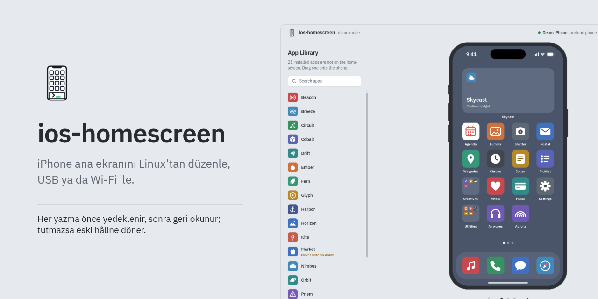
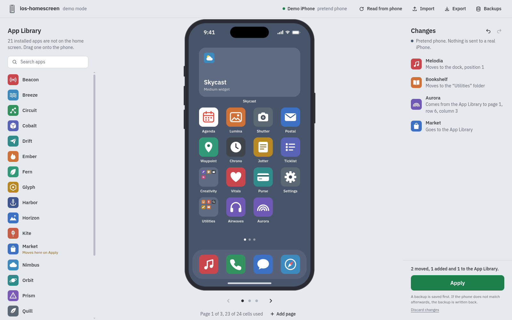

<h1 align="center">ios-homescreen</h1>

<p align="center">
iPhone ana ekranını Linux'tan okuyun, yeni düzeni bir metin dosyasında planlayın ve telefona güvenle yazın. USB ya da Wi-Fi ile.
</p>

<p align="center">
<a href="https://github.com/YakupEmreYerli/ios-homescreen/actions/workflows/ci.yml"></a>
<a href="LICENSE"></a>

</p>

<p align="center"><a href="README.md">English</a></p>



Onlarca simgeyi telefonda tek tek sürükleyerek yerleştirmek uzun sürüyor. ios-homescreen
mevcut düzeni bilgisayara kaydeder, istediğiniz metin düzenleyicide değiştirebileceğiniz bir
TOML dosyasına çevirir, yaptığınız değişiklikleri telefona dokunmadan denetler ve sonucu
telefona yazar. Her yazmadan önce yedek alır, telefonu yeniden okuyarak sonucu doğrular;
telefon istediğiniz düzene gelmediyse yedeği kendiliğinden geri yazar.

Simgeleri sürükleyerek çalışmayı seviyorsanız `ios-homescreen ui` aynı işi tarayıcıda açılan
bir düzenleyiciyle yapar.

## Özellikler

- Dock'u, sayfaları, klasörleri (çok sayfalı klasörler dahil), widget'ları, widget
  yığınlarını, web kısayollarını, Safari web uygulamalarını ve boşaltılmış uygulamaları
  düzenlenebilir bir TOML dosyasına aktarır.
- Uygulamalara paket kimliğiyle ya da simgenin altındaki adla başvurabilirsiniz.
- Düzeni telefona gitmeden denetler: bilinmeyen ya da iki kez kullanılan öğe, dolu dock,
  24 hücreyi aşan sayfa (widget'lar boyutlarına göre sayılır), boş ya da iç içe klasör,
  klasördeki widget.
- Düzene yazmadığınız uygulamalar Uygulama Arşivi'ne gider ve orada kalır.
- Yazmadan önce neyin taşınacağını, neyin arşive gideceğini ve neyin ana ekrana döneceğini gösterir.
- Yalnız açıkça `--yes` verildiğinde, yedekten sonra yazar ve sonucu telefonu yeniden okuyarak
  denetler. Tutmazsa yedeği geri yazar.
- USB ile çalışır; USB üzerinden bir kez kurduktan sonra Wi-Fi ile de (iOS 17 ve sonrası).
  İkisi için de root ya da Geliştirici Modu gerekmez.
- Okumaları, yedekleri ve planları çalışma klasörüne değil `~/.local/share/ios-homescreen`
  altına kaydeder.
- Tarayıcıda çalışan bir düzenleyicisi var (`ios-homescreen ui`): uygulamaları, klasörleri ve
  widget'ları ana ekranın resmi üzerinde sürüklersiniz, her değişikliği telefona yazılmadan önce
  görürsünüz, aynı güvenlik adımlarıyla uygularsınız. Telefon olmadan denemek için bir demo
  modu da var.
- Python'dan da kullanılabilir: komut satırı, `ios_homescreen.api` üzerine ince bir katman.

## Gereksinimler

- Linux. macOS'ta çalışabilir ama denenmedi.
- Python 3.11 ya da üstü.
- Kurulu ve çalışan `usbmuxd`. Çoğu dağıtımda paketin adı `usbmuxd`
  (`sudo pacman -S usbmuxd`, `sudo apt install usbmuxd`, `sudo dnf install usbmuxd`).
- Bu bilgisayara güvenen bir iPhone. Kabloyla bağlayın, kilidini açın, **Bu Bilgisayara Güven**
  sorusuna Güven deyin ve parolayı girin. Bunu bir kez yapmanız yeterli.

## Kurulum

[uv](https://docs.astral.sh/uv/) ile:

```bash
uv tool install git+https://github.com/YakupEmreYerli/ios-homescreen
```

[pipx](https://pipx.pypa.io/) ile:

```bash
pipx install git+https://github.com/YakupEmreYerli/ios-homescreen
```

Tarayıcı düzenleyicisi Starlette ve uvicorn kullanır; ikisi de pymobiledevice3 ile zaten
kurulur. `ui` eki bunları ayrıca adıyla ister, ileride değişirse diye:

```bash
uv tool install "ios-homescreen[ui] @ git+https://github.com/YakupEmreYerli/ios-homescreen"
```

Geliştirmek için depodan:

```bash
git clone https://github.com/YakupEmreYerli/ios-homescreen
cd ios-homescreen
uv sync
uv run ios-homescreen --help
```

## Hızlı başlangıç

```bash
# 1. Mevcut düzeni kaydet. Yalnız okur, telefona hiçbir şey yazmaz.
ios-homescreen read

# 2. Son okumayı düzen dosyasına çevir ve düzenle.
ios-homescreen export -o layout.toml
$EDITOR layout.toml

# 3. Düzeni denetle, neyin değişeceğini gör. Telefona bağlanmaz.
ios-homescreen plan layout.toml -o plan.plist

# 4. Yaz. Yedek, yazma, doğrulama, gerekirse geri dönüş.
ios-homescreen apply plan.plist --yes
```

Geri almak için `apply` komutunun yazdığı yedeği geri yükleyin:

```bash
ios-homescreen restore ~/.local/share/ios-homescreen/backups/backup-20261010-101500-000000.plist --yes
```

## Komutlar

| Komut | Ne yapar | Telefona bağlanır mı |
| --- | --- | --- |
| `read` | Düzeni ve kurulu uygulamaları bir okuma dosyasına, yanına da metin özetine kaydeder | Yalnız okur |
| `export [READ]` | Bir okumanın düzenini (varsayılan: en yenisi) TOML olarak ekrana basar, `-o FILE` ile dosyaya yazar | Hayır |
| `plan LAYOUT` | Düzeni bir okumaya göre denetler (`--read`, varsayılan: en yenisi), değişiklikleri gösterir, planı kaydeder | Hayır |
| `apply PLAN --yes` | Yedek alır, planı yazar, doğrular, tutmazsa geri döner | Yazar |
| `restore BACKUP --yes` | Bir yedeği ya da okumayı aynı güvenlik adımlarıyla geri yazar | Yazar |
| `diff BEFORE AFTER` | Kayıtlı iki düzeni karşılaştırır (okuma, yedek, plan ya da plist/JSON döküm) | Hayır |
| `wifi status\|enable\|disable` | Telefona Wi-Fi erişimini kurar, denetler ya da kapatır | Evet |
| `ui` | Tarayıcı düzenleyicisini 127.0.0.1 üzerinde açar | Okur; yalnız Uygula'ya basınca yazar |

`export` ve `plan` için `-o/--output FILE`; `plan` için ayrıca `--allow-removal` (düzen dosyası
bölümüne bakın). `read` için `-o/--output DIR`. `apply` için `--force` (güvenlik bölümüne bakın).
`diff` ve `wifi` dışındaki bütün komutlar `--data-dir DIR` alır.

Bağlantı seçenekleri (`read`, `apply`, `restore`, `wifi`, `ui`):

| Seçenek | Anlamı |
| --- | --- |
| *(yok)* | usbmuxd üzerinden USB |
| `--wifi` | Wi-Fi (iOS 17 ve sonrası); önce bir kez USB üzerinden `wifi enable` çalıştırın |
| `--udid UDID` | Birden çok cihaz bağlı ya da eşliyse birini seçer |
| `--discovery-timeout SECONDS` | Bonjour cevaplarının bekleneceği süre (varsayılan 5) |
| `--connect-timeout SECONDS` | Bağlantı kurma süre sınırı (varsayılan 30) |

Yazma seçenekleri (`apply`, `restore`; `--yes` dışındakiler `ui` için de geçerli):

| Seçenek | Anlamı |
| --- | --- |
| `--yes` | Zorunlu. Verilmezse telefona hiç bağlanılmaz |
| `--backup-dir DIR` | Otomatik yedeğin yeri (varsayılan `DATA_DIR/backups`) |
| `--verify-attempts N` | Yazmayı doğrulamak için yeniden okuma sayısı (varsayılan 6) |
| `--verify-interval SECONDS` | Bu okumalar arasındaki bekleme (varsayılan 3) |
| `--write-timeout SECONDS` | Düzeni gönderme süre sınırı (varsayılan 10) |
| `--read-timeout SECONDS` | Her okumanın süre sınırı (varsayılan 30) |

Çıkış kodları: `0` tamam; `1` hata (`apply` ve `restore` yazmadan önce durur); `2` kullanım
hatası ya da `--yes` eksik; `3` yeni düzen doğrulanamadı ve yedek geri yüklendi; `4` geri
yükleme de doğrulanamadı. Yedek dosyası her durumda kalır.

## Düzen dosyası

Düzende bir `[dock]` tablosu ve her sayfa için bir `[[pages]]` tablosu olur. Her birinde
ana ekran sırasıyla (soldan sağa, yukarıdan aşağı) bir `items` dizisi bulunur.

```toml
[dock]
items = ["Phone", "Safari", "Messages", "Camera"]

[[pages]]
items = [
  { type = "widget", id = "6F1D3A52-0000-4000-8000-000000000001" },  # Hava Durumu, orta boy
  "com.apple.mobilecal",        # Takvim, paket kimliğiyle
  "Mail",                       # ya da simgenin altındaki adla
  { type = "folder", name = "Utilities", items = ["Calculator", "Voice Memos", "Find My"] },
  { type = "folder", name = "Media", pages = [["Music", "Podcasts", "TV"], ["Books"]] },
  { type = "webclip", id = "0A1B2C3D4E5F40718293A4B5C6D7E8F9" },  # bir Safari yer imi
  { type = "webapp", id = "9E8D7C6B-0000-4000-8000-000000000002" },  # bir Safari web uygulaması
]

[[pages]]
items = ["Health", "Wallet"]
```

Uygulama adları telefonun diline göre değişir; Türkçe telefonda `"Takvim"`, `"Hesap Makinesi"`
gibi adlar yazılır. Paket kimliği her dilde aynıdır.

[`examples/layout.toml`](examples/layout.toml) Apple'ın hazır uygulamalarıyla yazılmış tam bir
örnek. Siz kendi dosyanıza `export` ile başlayın: gerçek kimlikleri doldurur ve her öğenin adını
yorum olarak ekler.

| Öğe | Nasıl yazılır | Not |
| --- | --- | --- |
| Uygulama | `"com.apple.Maps"` ya da `"Maps"` | Paket kimliği ya da, o adda tek uygulama varsa, adı. `{ type = "app", id = "com.apple.Maps" }` de olur ve yalnız kimlik kabul eder. Yalnız Uygulama Arşivi'nde duranlar dahil kurulu her uygulama eklenebilir. |
| Klasör | `{ type = "folder", name = "İş", items = [...] }` | Çok sayfalı klasör için `items` yerine `pages = [[...], [...]]`. İçine uygulama, web kısayolu ve web uygulaması konur. |
| Widget ya da widget yığını | `{ type = "widget", id = "..." }` | Küçük 4 hücre, orta 8, büyük 16. Dock'a ve klasöre konamaz. |
| Web kısayolu | `{ type = "webclip", id = "..." }` | Ana Ekrana Ekle ile eklenen yer imi. Taşınabilir, kaldırılamaz (aşağıya bakın). |
| Safari web uygulaması | `{ type = "webapp", id = "..." }` | Ana Ekrana Ekle'de "Web Uygulaması Olarak Aç" seçilerek eklenen site (iOS 26 ve sonrası). Safari'nin paket kimliğini taşır ama kendi kimliği vardır; Safari'den ayrı bir öğedir. Taşınabilir, kaldırılamaz. |

Planlayıcının uyguladığı kurallar:

- Dock'a en çok 4 öğe sığar. Bir sayfa 24 hücredir; uygulama, klasör, web kısayolu ve web
  uygulaması birer hücre tutar.
- Her öğe bir kez geçer. Aynı uygulamanın iki widget'ı, kimlikleri farklı iki ayrı öğedir.
- Klasörün adı ve en az bir öğesi olmalı; içinde klasör ya da widget olamaz.
- Widget, web kısayolu ve web uygulaması taşınabilir ama düzen dosyasıyla yeni oluşturulamaz.
  Okumadaki kimlikleriyle anılırlar ve planlayıcı telefonun kendi verisini olduğu gibi kopyalar.
  Bir widget'ı düzene yazmazsanız `plan --allow-removal` vermedikçe hata alırsınız.
- Web kısayolları ve Safari web uygulamaları yazarak hiç kaldırılamaz. Yazılan düzende biri
  eksikse telefon onu yeni bir son sayfaya geri koyuyor; yazmadan sonraki denetim tutmuyor ve
  yedek geri yükleniyor. Bu yüzden planlayıcı böyle bir düzeni `--allow-removal` verilse de
  reddeder (kod `not_removable`). Bunları telefonda silin (simgeye basılı tutun, Yer İşaretini
  Sil), sonra yeniden `read` çalıştırın.
- Düzende olmayan her kurulu uygulama Uygulama Arşivi'ne gider.
- Bilinmeyen anahtar hata sayılır; `itmes` gibi bir yazım hatası bir sayfayı sessizce boşaltmaz.

`plan` bulduğu her sorunu yeriyle birlikte yazar, örneğin
`page 2, item 5: unknown app 'Mpas'`.

## Tarayıcı düzenleyicisi



`ios-homescreen ui` telefonu okur ve tarayıcıda bir düzenleyici açar. Uygulamaları, klasörleri
ve widget'ları ana ekranın resmi üzerinde, sayfalar arasında ve dock'a sürükleyebilirsiniz. Bir
uygulamayı ötekinin üstüne bırakınca klasör olur; klasöre tıklayınca açılır, adını orada
değiştirir, içine uygulama atar ya da çıkarırsınız. Soldaki Uygulama Arşivi, kurulu olup ana
ekranda olmayan uygulamaları gösterir: oradan ana ekrana sürükleyin ya da ana ekrandan kaldırmak
istediklerinizi oraya bırakın. Sağ tarafta son okumaya göre değişen her şey listelenir; düzen
siz çalışırken `plan` ile aynı kurallarla denetlenir.

Uygula önce onay ister, sonra `apply` ile aynı adımlardan geçer: yedek, yazma, geri okuma,
tutmazsa geri dönüş. İlerleme ve sonuç sayfada görünür. Yedekler, otomatik alınan yedekleri
listeler ve birini aynı yolla geri yükler. İçe ve Dışa Aktar TOML düzen dosyasını yükler ve
kaydeder; düzenleyiciyle metin düzenleyicisi arasında gidip gelebilirsiniz.

```bash
ios-homescreen ui              # USB ile; Wi-Fi için --wifi ekleyin
ios-homescreen ui --demo       # uydurma uygulamalı bir deneme iPhone'u
```

| Seçenek | Anlamı |
| --- | --- |
| `--port PORT` | 127.0.0.1 üzerindeki port (varsayılan: boş herhangi bir port) |
| `--no-browser` | Yalnız adresi yazar, tarayıcı açmaz |
| `--demo` | Deneme iPhone'u kullanır; hiçbir telefona bağlanmaz, okumalar, yedekler ve planlar geçici bir klasöre gider |

Bağlantı ve yazma seçenekleri `apply` komutundaki gibi çalışır. `--yes` gerekmez, düzenleyici
kendisi sorar.

Düzenleyici yalnız 127.0.0.1'i dinler. Yazdığı adreste her açılışta değişen bir anahtar var;
sayfa bu anahtarı bir çereze çevirir. Her istek anahtarı taşımalı ve sayfanın kendisinden
gelmeli. Böylece aynı tarayıcıda açık başka siteler düzenleyiciyi kullanamaz, simgelerinizi ve
yedeklerinizi göremez. Bir widget'ı kaldırmak, `--allow-removal` gibi ayrı bir onay ister.
Ctrl+Z geri alır, Ctrl+Shift+Z yineler.

## Güvenlik modeli

Ana ekran protokolü belgelenmemiş. Araç yazılırken iki davranışı gerçek bir telefonda düzeni
bozdu; tasarım bu ikisinin etrafından dolaşıyor.

1. Telefona hangi uygulamaların ana ekranda olmayacağı söylenmeli. `setIconState` yalnız
   sayfa listesi alırsa SpringBoard, listede olmayan her kurulu uygulamayı (Uygulama Arşivi'ndekiler
   ve Apple'ın hazır uygulamaları dahil) ana ekranın sonuna ekliyor. ios-homescreen her zaman
   `{buttonBar, iconLists, ignored}` gönderir; `ignored`, ana ekranda olmayan bütün kurulu User
   ve System uygulamalarının listesidir. Bu liste yazma anında kurulu uygulamalardan yeniden
   hesaplanır.
2. Yazmanın güvenilir bir cevabı yok. SpringBoard `setIconState` isteğine çoğu zaman cevap
   vermiyor, pymobiledevice3'ün `set_icon_state` fonksiyonu da bu cevabı sonsuza kadar bekliyor.
   ios-homescreen isteği kendisi, süre sınırıyla gönderir ve cevap gelmemesini "belirsiz" sayar.
   Kanıt, telefonun yeniden okunan düzeninin planla aynı çıkmasıdır.

Her `apply` ve `restore` aynı adımlardan geçer:

1. Mevcut düzeni okur ve zaman damgalı yedek olarak kaydeder.
2. Düzen, planın yapıldığı okumadan farklıysa (telefon arada değiştiyse) durur. `--force` bu
   denetimi atlar. `restore` komutunda bu denetim yok.
3. Düzeni süre sınırıyla gönderir.
4. Düzeni yeni bir bağlantıyla en çok `--verify-attempts` kez yeniden okur ve planla
   karşılaştırır: her sayfada ve her klasörde öğe türleri, kimlikleri ve sırası.
5. Hiç tutmazsa yedeği aynı yolla geri yazar ve onu da doğrular.

`--yes` olmadan `apply` ve `restore` yalnız dosyayı denetleyip 2 koduyla çıkar, telefona
bağlanmaz. Okumalar, yedekler ve planlar ikili plist olarak saklanır, çünkü düzende JSON'un
kaybedeceği tarih ve ikili veri var.

## Wi-Fi

Wi-Fi için iOS 17 ya da sonrası gerekir. Telefon USB ile bağlıyken bir kez kurun:

```bash
ios-homescreen wifi enable     # USB üzerinden, bir kez
ios-homescreen wifi status     # ayar, eşleşme ve telefonun Wi-Fi'de cevap verip vermediği
```

`wifi enable` telefondaki Wi-Fi bağlantısı ayarını açar ve bu bilgisayarı Wi-Fi için
RemotePairing ile eşler; Xcode kablosuz cihazlar için aynı yolu kullanır. Bilgisayar USB
üzerinden zaten güvenilir olduğu için telefonda bir soru çıkmaz. Root, Geliştirici Modu ya da
ayrı bir tünel servisi gerekmez: bağlantı, pymobiledevice3'ün ios-homescreen sürecinin içinde
çalışan ağ yığınından geçer.

Bundan sonra `read`, `apply`, `restore` ya da `ui` komutuna `--wifi` ekleyin. Telefon
bilgisayarla aynı ağda, uyanık ve kilidi açık olmalı. ios-homescreen telefonu
`--discovery-timeout` saniye boyunca Bonjour ile (`_remotepairing._tcp`) arar ve adresinden
değil eşleşmeden tanır; iOS özel ve değişen Wi-Fi adresleri kullanıyor. Bilgisayar birden çok
telefonla eşliyse `--udid` verin.

Eşleşme, pymobiledevice3'ün tuttuğu bir dosyadır: `~/.local/share/pymobiledevice3/remote_<UDID>.plist`,
ya da bu klasör zaten varsa `~/.pymobiledevice3/`. İçinde bu bilgisayarın telefonla
konuşmasını sağlayan anahtar var; ios-homescreen onu hiçbir yere kopyalamaz ve göndermez.
`wifi disable` telefondaki ayarı kapatır, `wifi disable --forget` eşleşme dosyasını da siler.

Telefona ağ üzerinden ulaşmanın eski yolu (62078 portundaki lockdown, `_apple-mobdev2._tcp`
olarak bulunur) kullanılmıyor: güncel iOS sürümleri bu bağlantıyı kabul ediyor ama ilk istekte
her servisi kapatıyor.

## Dosyalar ve ortam değişkenleri

| Ne | Varsayılan | Değiştirmek için |
| --- | --- | --- |
| Okumalar, yedekler, planlar | `$XDG_DATA_HOME/ios-homescreen` ya da `~/.local/share/ios-homescreen` | `--data-dir`, `IOS_HOMESCREEN_DATA_DIR` |
| Uygulama simgesi önbelleği (tarayıcı düzenleyicisi, Python API) | `$XDG_CACHE_HOME/ios-homescreen` ya da `~/.cache/ios-homescreen` | `IOS_HOMESCREEN_CACHE_DIR` |
| Wi-Fi eşleşmesi (pymobiledevice3) | `$XDG_DATA_HOME/pymobiledevice3` ya da `~/.local/share/pymobiledevice3` | `XDG_DATA_HOME` |

Veri klasöründe `reads/read-*.plist` (her birinin yanında `.txt` özeti),
`backups/backup-*.plist` ve `plans/plan-*.plist` bulunur. Siz bir yol vermedikçe çalışma
klasörüne hiçbir şey yazılmaz.

## Python API

```python
import asyncio
from ios_homescreen import api


async def main():
    device = await api.connect(api.Transport())  # Wi-Fi için api.Transport(wifi=True)
    try:
        snapshot = await api.read_device(device)
        view = api.describe(snapshot)  # arayüz için JSON'a hazır düzen
        plan = api.plan_layout(api.to_document(view), snapshot)
        result = await api.apply_plan(
            device,
            plan.payload,
            backup_dir=api.data_dir() / "backups",
            on_event=lambda event: print(event.message),
        )
        print(result.status)
    finally:
        await device.close()


asyncio.run(main())
```

İlerleme, değişmeyen bir `code` alanı taşıyan `Event` nesneleriyle gelir. Sonuçların ve
hataların `to_dict()` metodu ve makinenin okuyabileceği kodları var. `api.fetch_icons`
uygulama simgelerini PNG baytları olarak döndürür, `api.describe_changes(before, after)` iki
görünüm arasındaki farkları listeler.

## Sınırlar

- Protokolde gizli ana ekran sayfaları için bir ayar yok; ios-homescreen sayfa gizleyemez ya da
  gösteremez.
- Bugün görünümü ve Kilitli Ekran widget'ları ana ekran düzeninin parçası değil, kapsam dışında.
- Widget taşınabilir ya da kaldırılabilir ama oluşturulamaz. Web kısayolu ve Safari web
  uygulaması yalnız taşınabilir; onları telefonda silin.
- Düzen yazınca, ne göstereceğini sizin seçtiğiniz widget'lar (örneğin bir yığında seçili
  widget) varsayılan seçime dönebilir: SpringBoard yazma sırasında bu seçimi bırakıyor (iOS 27'de
  görüldü). Yazmadan sonraki denetim de bu yüzden bu seçime bakmaz.
- Wi-Fi için iOS 17 ya da sonrası gerekir.
- Boş sayfalar yazılmaz; SpringBoard onları tutmuyor.
- Sayfa kapasitesi iPhone ızgarasına (6'ya 4) göre hesaplanır. iPad'de denenmedi.
- Düzen biçimi Apple'ın ve belgelenmemiş; bir iOS güncellemesi onu değiştirebilir.
  Güncellemeden sonra önce `read` çalıştırın; biçim değişirse yedek ve geri dönüş bunun için var.
- Yazma biçimi iOS 26 ve iOS 27 çalışan bir iPhone 15'te doğrulandı.

## Sorun giderme

`no iPhone found over USB`: telefonu takın, kilidini açın ve usbmuxd'nin çalıştığına bakın
(`systemctl status usbmuxd`). Bazı dağıtımlarda udev, usbmuxd'yi yalnız bir cihaz takılınca başlatır.

Bir komut takılıyor ya da önceki bir oturumdan sonra her bağlantı zaman aşımına düşüyor:
usbmuxd bazen bir oturumdan sonra cevap vermez oluyor. `sudo systemctl restart usbmuxd` ile
yeniden başlatın ve telefonu yeniden takın.

İlk bağlantıda `Mux error -8` ya da bir eşleşme hatası: telefon bu bilgisayara henüz güvenmiyor.
Kilidini açın, **Bu Bilgisayara Güven** deyin, parolayı girin ve komutu yeniden çalıştırın.

`the iPhone did not answer on the network`: telefonla bilgisayarın aynı ağda olduğuna, telefonun
uyanık ve kilidinin açık olduğuna bakın; USB üzerinden `wifi status` telefonun cevap verip
vermediğini gösterir. Misafir ağları ve istemci yalıtımı ikisini birbirinden ayırır; güvenlik
duvarı mDNS'e (UDP 5353) izin vermeli.

`this computer has no Wi-Fi pairing yet` ya da eski bir pymobiledevice3 sürümünün yaptığı
eşleşme: USB üzerinden `wifi enable` komutunu yeniden çalıştırın.

Tarayıcı, sayfanın terminaldeki adresi istediğini söylüyor: `ios-homescreen ui` komutunun
yazdığı adresin tamamını açın. İçindeki anahtar düzenleyici her açıldığında değişir.

`the device layout changed since the read`: `read` komutundan sonra telefonda düzen değişmiş.
Yeniden `read` ve `plan` çalıştırın; eminseniz `--force` kullanın.

Çıkış kodu 3 (geri dönüldü): telefon yeni düzeni zamanında göstermedi. SpringBoard, özellikle
Wi-Fi'de, yavaş kalabiliyor. `--verify-attempts 10 --verify-interval 5` deneyin.

## Katkı ve güvenlik

Kurulum, testler ve tasarımın arkasındaki tuzaklar için [CONTRIBUTING.md](CONTRIBUTING.md)
dosyasına bakın. Güvenlik sorunlarını [SECURITY.md](SECURITY.md) dosyasında anlatıldığı gibi
gizli olarak bildirin.

## Teşekkür

`ignored` listesi taşıyan sözlük yükü, [chungty/unjiggle](https://github.com/chungty/unjiggle)
projesinin 4 numaralı çekme isteğinin `setIconState` hakkında bulduklarına dayanıyor.
[facebook/idb](https://github.com/facebook/idb) içindeki ana ekran biçimi notları da yol gösterdi.
İki projeden de kod kopyalanmadı.

Cihazla iletişim [pymobiledevice3](https://github.com/doronz88/pymobiledevice3) (Wi-Fi için
RemotePairing desteği ve kullanıcı alanındaki tüneli dahil), USB erişimi libimobiledevice
projesinin [usbmuxd](https://github.com/libimobiledevice/usbmuxd) aracı üzerinden yürüyor.
Tarayıcı düzenleyicisi [Preact](https://preactjs.com) ve [htm](https://github.com/developit/htm)
ile yazıldı, [Starlette](https://www.starlette.io) ve [uvicorn](https://www.uvicorn.org) ile
sunuluyor.

## Lisans

[MIT](LICENSE). ios-homescreen, GPL-3.0-or-later lisanslı pymobiledevice3'e bağımlıdır; ikisini
tek bir program olarak birlikte dağıtırsanız bu birleşim GPL kapsamına girer. Tarayıcı
düzenleyicisi Preact (MIT) ve htm (Apache-2.0) kütüphanelerinin ve IBM Plex Sans yazı tipinin
(SIL Open Font License 1.1) değiştirilmemiş kopyalarını içerir; lisansları yanlarında,
[`src/ios_homescreen/ui/static/vendor`](src/ios_homescreen/ui/static/vendor) ve
[`src/ios_homescreen/ui/static/fonts`](src/ios_homescreen/ui/static/fonts) klasörlerinde.
